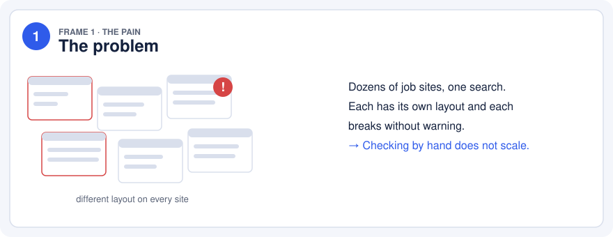
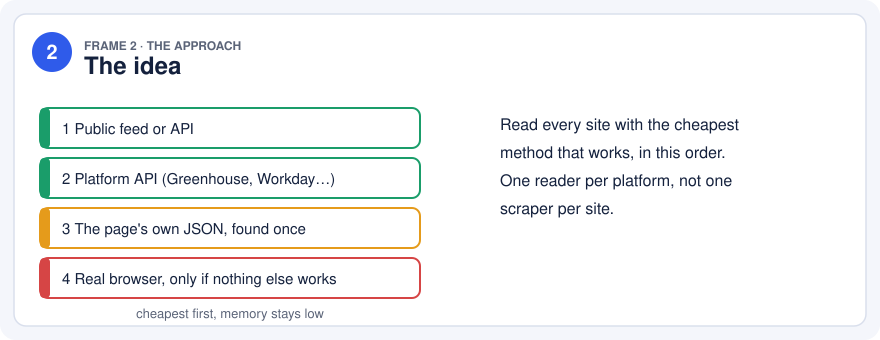
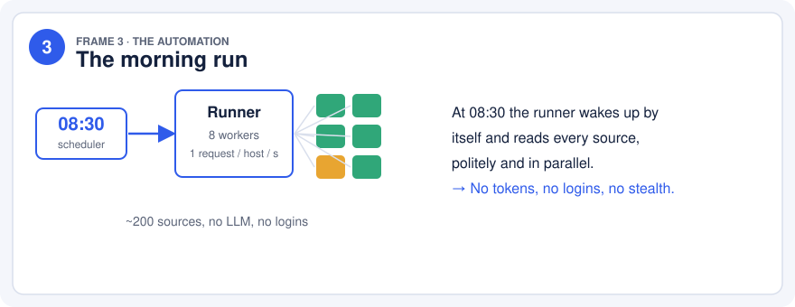
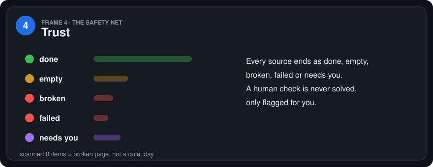
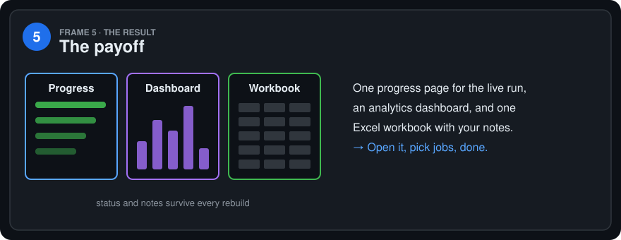
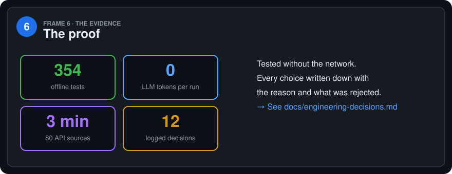
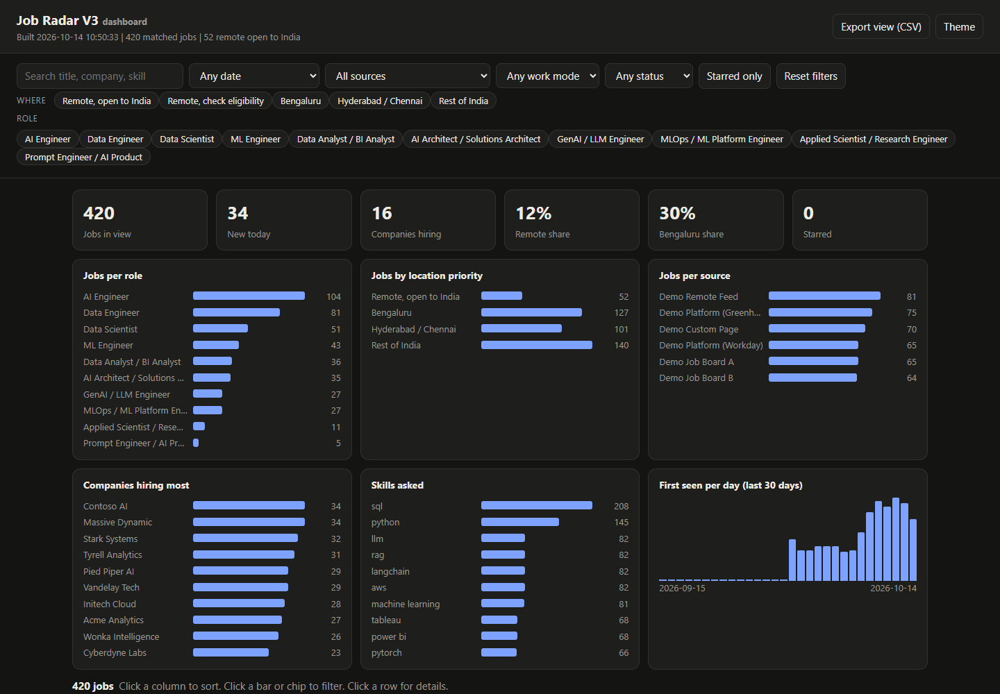

# AI Projects

Hands-on AI and data projects, built end to end: design decisions written down, tests included, nothing hidden behind a demo.

| Project | In one line | Stack |
|---|---|---|
| **[Job Radar](job-radar/)** | A free, no-LLM pipeline that reads about 200 job sources every morning and turns them into a dashboard | Python, Playwright, JobSpy, 354 offline tests |

---

## Job Radar in six frames

> A storyboard of the project: the problem, the idea, what runs at 08:30, how it stays trustworthy, what you see, and the proof.

### The result, on invented demo data

*Try it: `python job-radar/demo/make_demo.py`, then open `job-radar/demo/output/Dashboard.html`. The repository ships no scraped data.*

### Where to go next

- **[Full project README](job-radar/README.md)**: architecture diagram, reliability, layout, how to run.
- **[Engineering decisions](job-radar/docs/engineering-decisions.md)**: twelve choices, each with the reason and the options that were rejected.
- **[Product requirements](job-radar/docs/PRD-job-radar-v3.md)** and **[how each site is read](job-radar/docs/ARCHITECTURE-sources.md)**.

### Responsible use

Personal, low-volume use. No logins, no CAPTCHA bypass, a polite request rate. Check each site's terms before you use it.

---

By [Rakshith Nayak](https://github.com/nayakrakshith007). MIT licence.
