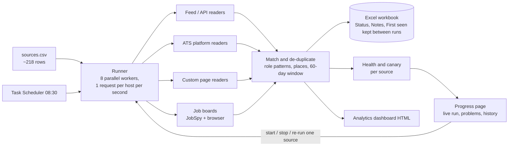

**New here?** Start with the [six-frame storyboard](docs/STORYBOARD.md), a two-minute tour of the project.

# Job Radar V3

A free, no-LLM data pipeline that reads about 200 job sources every morning, keeps the roles that match, and shows the result on a live progress page, an HTML analytics dashboard and one Excel workbook.

> This repository is a showcase of the code, the architecture and the decision process. It ships **no scraped data, no personal files and no credentials**. Real runs write their output to `radar3/output/`, which is git-ignored.


*The analytics dashboard, built from invented demo data. Try it yourself: `python demo/make_demo.py`, then open `demo/output/Dashboard.html`.*

## The problem

Looking for a remote AI/ML job means checking dozens of boards and company career pages, each with a different layout, each breaking without notice. A scraper per site does not scale, and a browser per site does not fit in 16 GB of memory.

## The approach

Read every site with the **cheapest method that works**, in this order:

1. A public feed or JSON API.
2. The hiring platform's public API (Greenhouse, Ashby, Lever, Workable, Workday and others).
3. The JSON that a career page calls itself, found once with a browser during development, then called with plain HTTP.
4. A real browser (Playwright), only where nothing else works.

The daily run uses no LLM tokens, no logins and no stealth. A human check (CAPTCHA) is never solved or hidden: the source is marked "needs you" and skipped.



## What makes it reliable

- **Source health, not just job counts.** Every source ends a run as done, empty, broken, failed or "needs you". A reader reports how many items it scanned, so a true zero is told apart from a broken page. A source that returns nothing twice in a row is flagged (the canary).
- **Safe by default.** Files are replaced atomically, so a workbook open in Excel never crashes a run. One request per host per second. Per-source time limits.
- **State survives.** Status, Notes and First seen carry from one build to the next, so a hand-edited workbook is never overwritten.
- **One progress page** shows the live run, per-source results, problems with the reason and what to do, and run history. It can start, stop or re-run a single source.
- **Tested.** 354 offline tests (`python -m pytest`) with saved page fixtures, so no test touches the network.

## Layout

| Path | What it holds |
|---|---|
| `radar3/` | The package: runner, readers, matching, workbook build, dashboard, progress page server, scheduler helper |
| `radar3/readers/` | One module per reader type: feeds, ATS platforms, custom pages, keyword matching |
| `radar3/data/sources.csv` | The source list: one row per site with its reader type and status |
| `radar3/tests/` | Offline tests and saved fixtures |
| `pipeline/`, `naukri/`, `linkedin/`, `indeed/`, `hirist/`, `iimjobs/`, `cutshort/`, `wellfound/` | The board workflows that V3 reuses |
| `discovery/` | The scripts used to probe sites and choose a reader for each |
| `docs/` | PRD, architecture notes and the decision documents |

## Run it

```bash
python -m venv .venv
.venv\Scripts\pip install -r requirements.txt
.venv\Scripts\python -m radar3 sources              # coverage and what is due
.venv\Scripts\python -m radar3 run --skip-boards    # fast sources only
.venv\Scripts\python -m radar3 tracker              # progress page on http://127.0.0.1:8771
.venv\Scripts\python -m radar3 dashboard            # rebuild the analytics page
```

The job boards (LinkedIn, Naukri, Indeed and others) take about 40 minutes and use a visible browser. Windows is the tested platform.

## Responsible use

Personal, low-volume use. The code respects `robots.txt` decisions recorded in the source list, keeps a polite request rate, uses no logins and does not bypass bot protection. Check each site's terms before you use it.

## Documents

- [Product requirements](docs/PRD-job-radar-v3.md)
- [Engineering decisions, with reasons and rejected options](docs/engineering-decisions.md)
- [How each site is read, and why](docs/ARCHITECTURE-sources.md)
- Decision documents: `docs/Architecture_and_Tech.html`, `docs/Product_Decisions.html`
